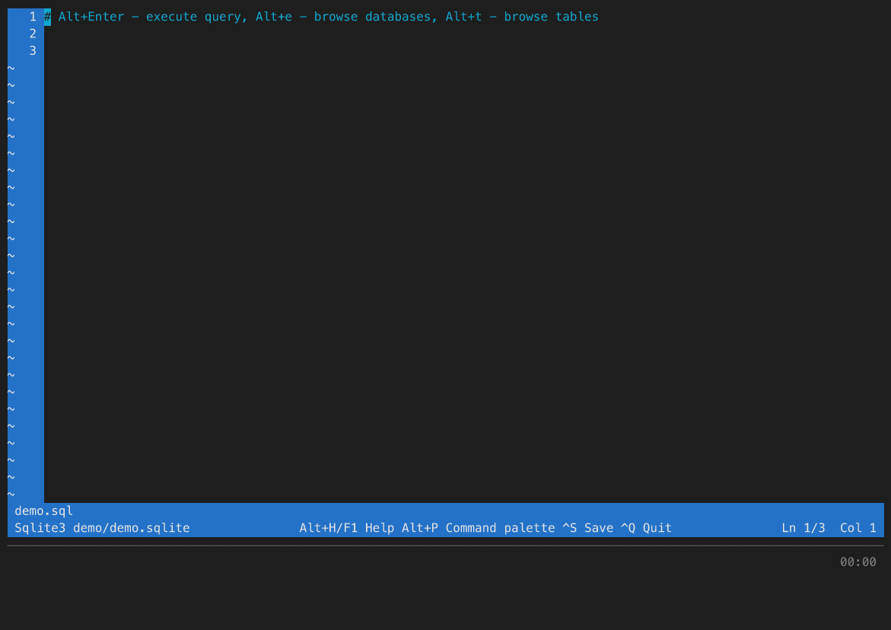

# DbCls

DbCls is a terminal database client in which a SQL editor and [visidata](https://www.visidata.org/) work as one thing: you write the query in an editor with syntax highlighting and schema-aware autocomplete, and its result opens straight away as an interactive table you can filter, sort, pivot, reshape, chart and drill into. On top of that sits a pipeline language that turns the editor into the place multi-step work happens — "collect ids from one query, run them against every shard, show progress" — right inside the `.sql` file, instead of in a throwaway Python script.

## Key capabilities

**Editor**
- SQL editor with syntax highlighting, `>>> ... <<<` block folding, search, undo/redo and a command palette
- Schema-aware autocomplete ranked by SQL context: tables, columns, table aliases, functions, keywords
- Beautify SQL (`Ctrl+B`), read-only mode, remappable key codes and a tmux-style `Ctrl+X` prefix

**Pipelines**
- Steps chained with `|` right in the editor: SQL, Python, regex filters, loops, functions, variables
- Prompts mid-run (`choose` / `select` / `input` / `ask`) — a pipeline becomes a small tool a colleague can use without knowing the schema
- A pipeline is just text in your `.sql` file: save it, version it, re-run it

**LLM chat (optional)**
- `Ctrl+L` — a model writes and fixes queries, reading your schema through read-only tools
- Any OpenAI-compatible endpoint (Ollama, vLLM, OpenRouter, a corporate proxy); nothing to install

**Data**
- The whole of visidata: filtering, sorting, pivots, frequency tables, joins between sheets
- DB-aware extensions: cross-sheet references, in-terminal charts (plotext), export to SQL `INSERT`, and table editing that shows you the SQL before anything is committed

**Connecting and extending**
- MySQL, PostgreSQL, ClickHouse, SQLite — and Cassandra / ScyllaDB through the driver plugin in [`plugins/cassandra`](plugins/cassandra)
- With no connection arguments it starts on an in-memory SQLite — just open a file and type
- Unix sockets (including ones forwarded over SSH), JSON config, inactivity screen lock
- Plugin API: your own editor commands, pipeline commands, syntax highlighters, LLM tools and full-screen windows

## Documentation

This page is the short version. The details live in [`docs/`](docs/README.md):

| Page | What is in it |
|------|---------------|
| [Configuration and connections](docs/configuration.md) | Command line options, the config file, several connections and tabs, describing a connection in the editor, Unix sockets and SSH tunnels, logging |
| [Editor](docs/editor.md) | Hotkeys, fold blocks, syntax highlighting, key remapping and `Alt` on macOS, the `Ctrl+X` prefix, autocomplete, beautify, browsing and editing tables |
| [Results in VisiData](docs/visidata.md) | Sheets, DB-aware hotkeys, JSON / URL / size column types, aggregators, charts, exporting, cross-sheet references, expression functions |
| [Pipelines](docs/pipelines.md) | The language: steps, control flow, functions, live sheets (`.WATCH`), prompts, helpers, templates, examples |
| [LLM chat](docs/llm.md) | Setup, the chat window, questions from the model, approving tool calls, how the answer arrives |
| [Plugins](docs/plugins.md) | Writing a plugin, where plugins are loaded from, settings, the plugin API, the bundled plugins |
| [Screen lock and password safety](docs/security.md) | Locking the terminal after inactivity, keeping passwords off disk |

## Demo

Four recordings of a real session — the captions under the terminal say what is
happening and which key was pressed.

### The editor

Syntax highlighting, `Ctrl+B` to beautify, schema-aware autocomplete, the
database and table browsers, and editing table data with the SQL shown before
anything is committed. See [Editor Commands](docs/editor.md).



### The result

Every query opens as a visidata sheet: sorting, a frequency table, key columns
and an in-terminal chart. See [Data Visualization](docs/visidata.md).


### Pipelines in the editor

A chain of steps in the editor: a prompt in the middle of a run, a fan-out over
shards, a live monitor, and a file of named blocks used as a menu. See
[Pipelines](docs/pipelines.md).


### The model

`Ctrl+L` — the model reads the schema through read-only tools and hands back a
query, then a pipeline. See [LLM Chat](docs/llm.md).


## Installation

```bash
pip install dbcls
```

Cassandra / ScyllaDB is not part of the package: it is a [driver plugin](docs/plugins.md) in this repository, loaded from a checkout.

```bash
pip install scylla-driver
dbcls --plugin-dir ./plugins -E cassandra -H node1 -P 9042 -u admin -d my_keyspace
```

The [LLM chat](docs/llm.md) needs nothing installed — it talks to the endpoint over the standard library and is switched on by configuration alone.

## Quick Start

With no connection arguments at all, dbcls opens the file on an in-memory SQLite database —
enough to try the editor, the pipelines and the visidata integration on `CREATE TABLE` /
`INSERT` of your own:
```bash
dbcls scratch.sql
```

Basic usage with command line arguments:
```bash
dbcls -H 127.0.0.1 -u user -p mypasswd -E mysql -d mydb mydb.sql
```

A JSON config file does the same job as the options, and holds several
connections at once — one tab each:

```bash
dbcls -c config.json mydb.sql
```

```json
{
    "connections": {
        "mysql01": {"engine": "mysql", "host": "127.0.0.1", "username": "user",
                    "ask_password": true, "dbname": "shop", "filename": "mysql.sql"},
        "local":   {"engine": "sqlite3", "dbfilepath": "test.sqlite", "filename": "local.sql"}
    }
}
```

Every option, the config file keys, tabs and the in-editor connection form are
in [Configuration and connections](docs/configuration.md); `F1` inside dbcls
opens the same help.

## Supported Database Engines

- MySQL
- PostgreSQL
- ClickHouse
- SQLite
- Cassandra / ScyllaDB — as a [driver plugin](docs/plugins.md): `pip install scylla-driver` and start with `--plugin-dir ./plugins`

A database not on this list is added from outside, without touching dbcls: a plugin registers its own engine with `setup.add_engine(...)`, and it is then a `--engine`, an `"engine"` in the config file and an entry in the connection form like any other. [`plugins/cassandra`](plugins/cassandra) is the worked example.

## Contributing

Contributions are welcome! Please feel free to submit a Pull Request or submit an issue on [GitHub Issues](https://github.com/Sets88/dbcls/issues)

## License

[here](https://github.com/Sets88/dbcls/blob/main/LICENSE)
